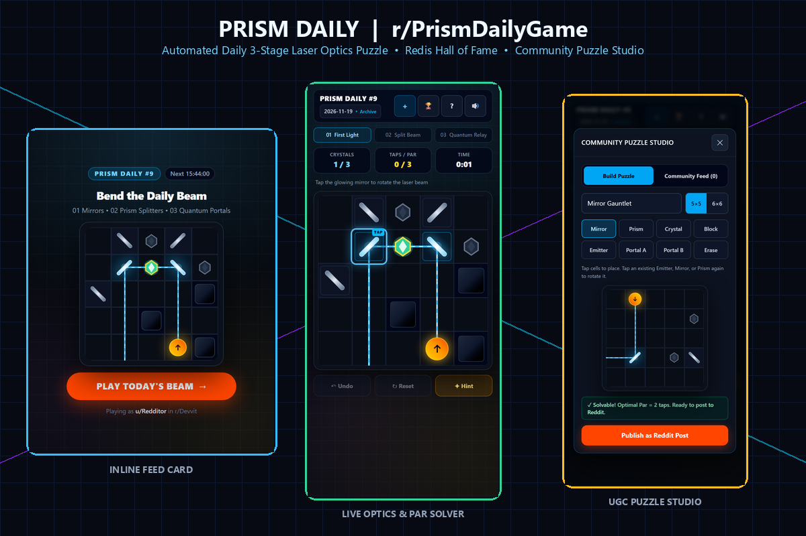

# Devpost Submission — PRISM DAILY (v1.0)

## Project Name
**PRISM DAILY**

## Elevator Pitch
Bend the daily laser beam through mirrors, prism splitters, and quantum portals to ignite every crystal in optimal Par moves — right inside a Reddit post.

## About the Project (Markdown)

## Inspiration
Great Reddit daily games like `r/hotandcold`, `r/pocketgrids`, and `r/pixelary` share two qualities: you understand them in two seconds without reading a manual, and finishing them immediately makes you want to compare your run in the comments. **PRISM DAILY** brings tactile optical physics — glowing laser beams, mirrors, diamond prism splitters, and twin quantum portals — directly into the Reddit feed with zero external asset bloat, automated daily recurring posts, and mathematically guaranteed solvability.

## What it does
- **Living Inline Feed Card (`splash.html`):** Right inside the subreddit feed, players see today's optical bench pulsing with a non-spoiling animated laser preview, today's `#1` subreddit leader with Snoovatar, live solver count, active streak, and a real-time countdown to the next UTC midnight beam.
- **Zero-Text Contextual Onboarding:** First-time players immediately see a subtle cyan `TAP` beacon on a mirror currently touched by the live laser beam — their very first tap bends the beam dynamically across the board with zero tutorial walls.
- **3-Stage Progressive Daily Run (`game.html`):** Every UTC midnight deterministically generates a fresh 3-stage pack shared by the entire community:
  1. **First Light (5×5):** Mirrors (`/` `\`) and obsidian blockers.
  2. **Split Beam (6×6):** Adds diamond prism splitters that pass light straight *and* reflect 90°.
  3. **Quantum Relay (6×6):** Combines prism splitters with twin wormhole portals (`A ↔ B`) that visibly surge and resonate when light teleports through them.
- **Exact Optimal Par, Server Integrity & Smart Hint Engine:** An exhaustive bitmask solver verifies every generated stage so every single calendar day is provably solvable with an exact minimum-tap Par. The server independently recalculates authoritative Par on `/api/submit-run` (preventing spoofed sub-Par scores), and the Smart Hint button prioritizes the next optimal mirror currently hit by the live beam.
- **Automated Daily Recurring Content (`0 0 * * *` Cron):** Configured via Devvit `scheduler.tasks` (`/internal/scheduler/daily-post`) with Redis idempotency keys and moderator controls so a fresh playable Interactive Post drops automatically at 00:00 UTC every day.
- **Native Reddit Community Loop:**
  - **2-Tab Subreddit Rankings:** Today's Top 15 leaderboard + All-Time Subreddit Hall of Fame (`Par Masters`, `Total Solved`, `Best Streak`) with real Reddit usernames and cached Snoovatars.
  - **Subreddit Move-Distribution Histogram** and percentile rank (`Top X% of r/PrismDailyGame today`) + live `"Target to beat"` rival indicator.
  - **Daily Beam Archive Calendar:** Replay any past day from Launch Day #1 with personal `★ PAR` and `✓ Done` badges synced in Redis.
  - **Moderator Subreddit Settings:** Native Devvit settings (`autoPostDaily`, `awardUserFlairs`, `allowCommunityStudio`) plus automatic flair rewards (`PRISM 💎 Par Master` / `PRISM 🔥 Streak`).
  - **One-Click Spoiler-Free Comment Sharing:** Post your optical scorecard straight into the Reddit thread or native share sheet.
- **Community Puzzle Studio & Feed (UGC):** Players can paint their own 5×5 or 6×6 laser puzzle inside the app, verify solvability and exact Par live, publish it directly to the subreddit as a new playable Interactive Post (rate-limited per day to prevent spam), and browse/jump into recent community puzzles right from the Community Feed tab.

## How we built it
- **Platform:** Devvit Web (`@devvit/web` 0.15.4, `@devvit/start`), Hono server, Devvit Redis (sorted sets, hashes, rate limits, Snoovatar caching), Devvit Scheduler cron (`0 0 * * *`), Subreddit Settings, custom 1024×1024 `marketingAssets.icon`, and Reddit API (`submitCustomPost`, `submitComment`, `getSnoovatarUrl`, `setUserFlair`).
- **Frontend:** React 19, TypeScript, Tailwind CSS 4, custom multi-layer glowing SVG real-time raytracer with animated photon flow, bounce impact flares, crystal ignition shockwave rings, procedural WebAudio pentatonic/portal synths, native accessible `<dialog>` modals, 44×44px mobile touch targets, and full keyboard controls (`Arrows`, `Enter/Space`, `Z`, `R`, `H`, `M`).
- **Deterministic Verification:** Pure optics engine (`src/shared/prismEngine.ts`) with cycle-safe `(r, c, dir)` loop detection and bitmask solver, unit-tested across **100 consecutive calendar dates (300 stages)** to guarantee zero unsolvable puzzles and zero infinite portal loops.

## Challenges we ran into
- **Guaranteeing non-trivial daily puzzles:** Naive random placement creates trivial 1-tap boards or infinite mirror/portal loops. Adding a `(r, c, dir)` visited-state loop guard plus exhaustive bitmask solving ensures every UTC date yields genuinely engaging stages with exact provable Par.
- **First-tap comprehension without tutorial walls:** Our earliest onboarding highlight picked the lowest-index bitmask flip, which could highlight a dark corner mirror before the beam reached it. Prioritizing mirrors that are both optimal *and* currently touched by the live beam made tap #1 bend light immediately.
- **Subreddit launch-readiness:** Adding server-authoritative Par validation, per-user UGC publishing rate limits, explicit Devvit permissions, dark WebView background styles (`#070a10ff`), and moderator toggles ensured the app behaves like a production Reddit community game out of the box.

## Accomplishments that we're proud of
- Zero-bloat instantaneous WebView load inside Reddit (`~1.6 MB` including sourcemaps; zero external texture or audio files).
- 300/300 consecutive daily stages proven solvable in exact optimal Par moves by automated tests.
- Complete launch-quality Reddit ecosystem: automated daily UTC cron posts → living inline splash → zero-text onboarding → 3-stage optical challenge → Archive calendar → Daily & All-Time Hall of Fame → spoiler-free comment sharing → Community Puzzle Studio & Feed.

## What's next for PRISM DAILY
- Weekly community spotlight threads curating top-played puzzles built in Community Puzzle Studio.
- Chromatic RGB additive beam filters and head-to-head daily challenge links.

## Live Links (Verified)
- **Devpost Submission:** https://devpost.com/software/prism-daily
- **Playable Demo Post:** https://www.reddit.com/r/PrismDailyGame/comments/1y039g5/prism_daily_9_bend_the_beam_20261119/
- **Public Subreddit:** https://www.reddit.com/r/PrismDailyGame/
- **Reddit Developer App Listing:** https://developers.reddit.com/apps/prism-daily
- **Source Code:** https://github.com/DaoHuuTrong2404/prism-daily
- **Optional Feedback Survey (5 × $200 Feedback Awards):** https://forms.gle/dW45UgK6SctevE756
