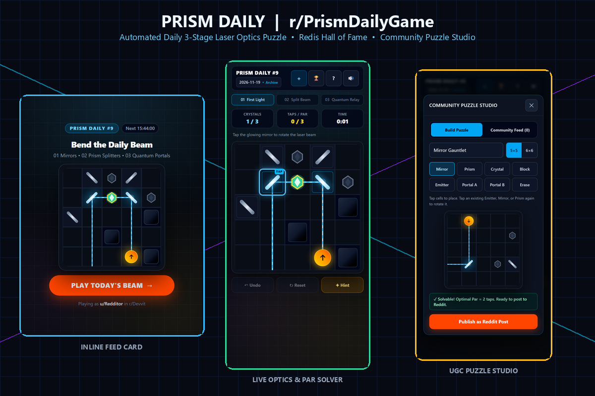

# PRISM DAILY — Reddit Daily Optics Puzzle



Bend the daily laser beam through mirrors, diamond prism splitters, and twin quantum portals to ignite every crystal in optimal Par moves — built natively for Reddit **Devvit Web**.

- **Play Live on Reddit:** https://www.reddit.com/r/PrismDailyGame/comments/1y039g5/prism_daily_9_bend_the_beam_20261119/
- **Public Subreddit:** https://www.reddit.com/r/PrismDailyGame/
- **Reddit Developer App:** https://developers.reddit.com/apps/prism-daily
- **Devpost Submission:** https://devpost.com/software/prism-daily

## Highlights
- **Automated Daily UTC Cron Scheduler (`0 0 * * *`):** Automatically publishes a fresh playable 3-stage `PRISM DAILY #N` Interactive Post every UTC midnight with Redis idempotency protection and live countdown clocks.
- **3 Progressive Daily Stages:** Scales from a 5×5 mirror warm-up (*First Light*) to 6×6 diamond prism splitters (*Split Beam*) and twin wormhole portals (*Quantum Relay*).
- **Mathematically Proven Solvability & Exact Par:** Constructively generated from the UTC date seed and verified with an exhaustive bitmask solver across 100 consecutive days (300 stages), powering exact Par scoring, server-authoritative run validation, and a live Smart Hint engine.
- **Contextual Zero-Text First-Tap Onboarding:** First-time players immediately see a gentle cyan pulse on the first interactive mirror — zero tutorial walls, instant aha moment.
- **Tactile Optical Craft:** Multi-layer glowing SVG beams, animated photon flow, bounce impact flares, crystal ignition shockwaves, active portal vortex resonance, procedural WebAudio pentatonic/portal synths, and full keyboard controls (`Arrows`, `Enter/Space`, `Z`, `R`, `H`, `M`).
- **Native Reddit Community Loop:**
  - Living inline feed card (`splash.html`) with animated non-spoiling beam preview, live `#1` subreddit leader ticker, solver count, streak flame, and next-beam UTC countdown.
  - 2-tab Subreddit Rankings (**Daily Run Top 15** + **All-Time Hall of Fame**) with Snoovatars and move-distribution percentile histograms.
  - Daily Archive Calendar Modal tracking personal `★ PAR` and `✓ Done` badges across every past day.
  - One-click spoiler-free score sharing directly into the Reddit post's comment thread or native share sheet.
  - Moderator-configurable Subreddit Settings (`autoPostDaily`, `awardUserFlairs`, `allowCommunityStudio`) and automatic flair unlocks.
- **Community Puzzle Studio & Feed (UGC):** Design 5×5 or 6×6 optical puzzles with live solvability/Par verification, publish directly as playable subreddit posts (rate-limited per day), and browse/play recent community-built puzzles right inside the app.

## Commands
```bash
npm install
npm run test:unit
npm run test:types
npm run lint
npm run build
npx devvit login
npx devvit upload
```
